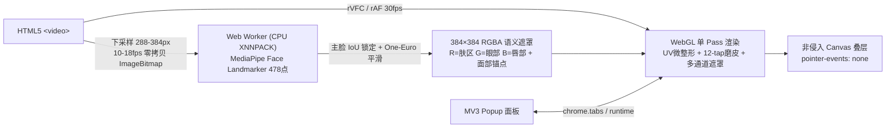

# 实时美颜（桌面 Chromium MV3 + iOS Safari）

> 本机实时网页视频美颜方案 —— **WebGL 单 Pass 26 项美颜/微整形 + MediaPipe 478 点人脸追踪**，无需服务器、不上传任何视频帧，桌面扩展零后台常驻开销，同时提供支持 **剧场全屏 + 一键 90° 横屏** 的 iOS Safari 用户脚本。

[](#)
[](#ios-safari-安装与横屏全屏)
[](#)
[](LICENSE)

---

## 核心特性

- **100% 本机离线推理与渲染**：所有视频帧与人脸关键点均在用户浏览器本地处理，零远端 API、零数据上报。
- **可选：视频本地缓存 + 内置播放器**（见下方「本地缓存与内置播放器」）：边看边把分片落到本地磁盘，之后用 `http://127.0.0.1:8765/` 打开自带播放器回看，**原站关掉、token 过期都不影响**，美颜面板一模一样地保留。
- **最小权限 & 按需注入**：美颜引擎申请 `activeTab`、`scripting`、`storage`，未点击扩展图标时不注入页面代码；透明缓存模块（`grab-hook`）只在 MissAV / Javrate / Avbebe 三个域名注入，**不碰其它站点**。
- **Wink / 剪映专业级 26 项分项美颜（单 Pass WebGL 管线）**：
  - **美肤（7 项）**：磨皮（12-tap 保边双边近似）、质感保留（高频肤质细节还原，避免塑料脸）、美白（高光保护冷白提亮）、红润（苹果肌暖色提气色）、去黑眼圈、淡法令纹、去油光（T 区高光柔化）。
  - **美型（8 项）**：瘦脸（下颌线收窄）、窄颧骨、下巴长短（`-50 ~ +50` 双向精调）、大眼、眼尾上扬（`-50 ~ +50` 双向精调）、瘦鼻、嘴型大小（`-50 ~ +50` 双向精调）、微笑唇；内置纵横比校正与侧脸对称度 `yawFactor` 自动衰减，避免侧脸背景拉扯。
  - **美妆（5 项）**：亮眼、立体修容（鼻影 + 下颌微阴影）、润唇口红 + **4 款唇色风格**（裸粉 / 蜜桃橘 / 玫瑰豆沙 / 复古正红）、牙齿美白。
  - **调色（6 项）**：清晰锐化（眼唇细节保边增强）、亮度曝光（`-50 ~ +50`）、对比度（`-50 ~ +50`）、饱和度（`-50 ~ +50`）、色温冷暖（`-50 ~ +50`）、氛围柔光（Orton 风格高光漫射）；全画幅调色在无脸或降级回退场景下同样生效。
  - **预设与方案管理**：内置 7 档风格预设（自然清透 / 冷白质感 / 日系柔光 / 纯欲微调 / 网感精修 / 减龄打底 / 归零）、本地「我的方案」保存、参数 JSON 导入导出与 **Wink/小红书中文配方文本一键解析**（直接粘贴 `小脸+20 眼睛倾斜-29 鼻子大小+34 口红/豆沙+18 饱和度-20 色温-8` 即可自动识别并跳过非面部项），双击任意滑块可单项归零。
- **双频解耦 & 丝滑防抖**：
  - 渲染主循环跟随视频帧（`requestVideoFrameCallback`，自动回退 `requestAnimationFrame`）；
  - 人脸追踪运行在独立 Module Web Worker（CPU XNNPACK / WASM SIMD，把 GPU 留给渲染与视频硬解），配合主脸 IoU 锁定、One-Euro 滤波与 ≤120ms 速度外推。
- **主流播放器通用适配 & 保护边界尊重**：
  - 自动适配 **XGPlayer（抖音等）**、**Plyr**、**Bilibili**、**YouTube** 与通用 HTML5 `<video>`（含开放 Shadow DOM 与同源 `iframe`）；
  - 精准支持 `object-fit: contain` / `cover` / `fill` 叠层对齐、悬停小预览降权、上下刷视频切条自动跟随、失焦暂停静态调参、容器全屏保持与原生 `<video>` 全屏自动回退；
  - 严格区分 **保护信号**（检测到 EME `mediaKeys` / `encrypted` 事件立即跳过取帧并保持原画）与 **取帧结果**（`可取帧 / 等待画面 / 跨域受限 / EME 已跳过 / 失败未确认`）；
  - **L0–L3 自动性能降级** 与 `webglcontextlost` 恢复，关闭美颜或离页时完整释放 Worker 与 WebGL 上下文。

---

## 架构概览



---

## 快速安装（桌面端 Chromium 浏览器）

### 方式一：直接下载 Release 预构建包（推荐普通用户）
1. 前往 [Releases 页面](https://github.com/woshixiaozhan123/realtime-beauty/releases) 下载 `realtime-beauty-v1.1.0.zip` 并解压。
2. 打开浏览器扩展管理页：
   - Chrome：`chrome://extensions`
   - Edge：`edge://extensions`
   - ego(lite)：`ego://extensions`
3. 开启右上角 **开发者模式** → 点击 **加载已解压/未打包的扩展程序** → 选择解压后的文件夹（包含 `manifest.json` 的目录）。
4. 打开任意 HTML5 视频页，点击工具栏扩展图标即可查看诊断并开启实时美颜。

### 方式二：从源码克隆构建（开发者）
> 需要 Node.js >= 18（零 npm 第三方运行时依赖）。

```bash
git clone https://github.com/woshixiaozhan123/realtime-beauty.git
cd realtime-beauty

# 1. 下载官方离线 MediaPipe WASM 与 478 点人脸模型到 vendor/mediapipe/
npm run setup

# 2. 校验语法、manifest 与资源完整性
npm run check

# 3. 打包可直接分发/提审的干净 zip 到 dist/
npm run build
```

> 若跳过 `npm run setup` 直接加载源码，扩展依然可以正常运行，并自动进入 **「WebGL 肤色保边回退模式」**（磨皮 / 质感保留 / 美白 / 红润 / 去油光 / 全部 6 项画面调色立即可用）。

---

## 本地缓存与内置播放器（可选）

`cache-server/` 是一个可选的本地 FastAPI 服务（`127.0.0.1:8765`），提供两件事：

1. **透明缓存**：扩展把播放器的 m3u8 改写到本地代理，每个分片先问本地、未命中才回源并顺手存一份。零额外流量，看完即已缓存。
2. **内置播放器**：浏览器打开 `http://127.0.0.1:8765/` 即进入媒体库，点开就是播放器，自带同一套 26 项美颜面板，**不需要扩展也能跑**。

```bash
cd cache-server
pip install -r requirements.txt
python main.py          # 打开 http://127.0.0.1:8765/
```

- 播放列表由**磁盘状态**现场生成，默认只列已落盘分片，原站 token 过期也能完整回看。
- 网页侧只对 MissAV / Javrate / Avbebe 生效（域名白名单），不影响任何其它站点。
- 详细架构、实测数据与踩坑记录见 [HANDOVER.md](HANDOVER.md)。

---

## iOS Safari 安装与横屏全屏

仓库内置与桌面端完全同步的 iOS Safari 用户脚本：[ios/realtime-beauty-ios.user.js](ios/realtime-beauty-ios.user.js)（同样具备全部 26 项参数、7 档预设、Wink 中文配方解析与可选 478 点追踪）。

### 安装步骤（Userscripts / Stay）
1. 在 App Store 安装免费开源的 **Userscripts**（或 **Stay**），并在 iOS「设置 → Safari 浏览器 → 扩展」中开启并授予网站权限。
2. 下载或直接从 Raw 链接安装脚本：
   `https://raw.githubusercontent.com/woshixiaozhan123/realtime-beauty/main/ios/realtime-beauty-ios.user.js`
3. 若使用 **Userscripts**：将脚本保存到 iCloud Drive /「我的 iPhone」下的 Userscripts 目录，刷新 Safari 视频页即可在右下角看到悬浮球。

### iOS 美颜剧场全屏 & 90° 横屏
- iOS 原生视频全屏会由系统 `AVPlayer` 接管并遮挡网页叠层；点击悬浮球旁的 **`⛶ 全屏`**（或面板底部的 **`⛶ 美颜全屏`**）即可进入美颜剧场全屏，完整保留美颜、进度条拖拽、倍速和实时调参。
- 即使手机开启了「竖排方向锁定」，点右上角 **`↻ 横屏90°`** 也能一键旋转横屏铺满观看。

---

## 浏览器兼容性与实测表现

在开启硬件加速的 Windows 桌面端通过可控测试页与主流视频站实测：

| 浏览器 | 状态 | 离线 478 点人脸遮罩 | 典型渲染耗时 (P95) |
| :--- | :--- | :--- | :--- |
| **Google Chrome** | ✅ 已验证 | 支持（CPU XNNPACK） | ~3.0–3.3 ms（L0） |
| **Microsoft Edge** | ✅ 已验证 | 支持（CPU XNNPACK） | ~3.0 ms（L0） |
| **ego(lite)** | ✅ 已验证 | 支持（CPU XNNPACK） | ~2.9–3.0 ms（L0） |

---

## 目录结构

```text
realtime-beauty/
├── manifest.json             # MV3 清单（icons + wasm-unsafe-eval）
├── icons/                    # 16 / 48 / 128 扩展图标
├── popup/                    # 26 项 Wink/剪映专业分项调参面板、预设、JSON 方案与诊断
├── content/engine.js         # 主引擎：选源、多播放器适配、EME/CORS探针、WebGL管线、L0-L3降级
├── content/grab-hook.js      # 透明 HLS 缓存 hook（域名白名单 + 改写 m3u8 到本地代理）
├── worker/face-worker.js     # 离主线程 MediaPipe 478 点推理、主脸锁定与 One-Euro 滤波
├── ios/                      # iOS Safari 用户脚本（26 项调参 + 美颜剧场全屏 + 90° 横屏）
├── cache-server/             # 可选本地服务：透明缓存 + 媒体库 + 内置播放器（FastAPI）
│   ├── hls_proxy.py          #   分片级透明缓存
│   ├── webui.py              #   媒体库 / 播放器 / 本地播放列表 / 缩略图
│   └── web/                  #   播放器前端（hls.js + chrome.tabs 垫片 + 复用 engine.js）
├── vendor/mediapipe/         # 离线 MediaPipe 模型与 ES Module WASM（npm run setup 拉取）
├── test-page/index.html      # 可控边界测试页（双人脸、同源iframe、cover/contain、全屏、EME）
├── scripts/                  # setup / check / build 零依赖 Node 脚本
└── .github/workflows/ci.yml  # GitHub Actions 自动校验与打包工作流
```

---

## 已知边界与限制

- **受 DRM (EME) 保护的流媒体**：遵循浏览器安全与版权机制，检测到 `mediaKeys` 或 `encrypted` 事件后主动跳过取帧并保持原画播放。
- **无 CORS 头的跨域直链视频**：浏览器 `texImage2D` 会按规范抛出 `SecurityError`，诊断面板将明确标记为「跨域受限」并保持原画（MSE `blob:` 流与同源流不受此限制）。
- **跨域 `iframe` 与自绘 `<canvas>` 播放器**：当前在诊断面板标记为待适配提示。
- **严格 CSP 网站**：若目标站点 CSP 禁止 `blob:` Worker，引擎会自动平滑降级至「肤色保边回退模式」，不中断播放。

---

## 开源协议与致谢

本项目采用 [MIT License](LICENSE) 开源；第三方模型与组件许可见 [THIRD_PARTY_NOTICES.md](THIRD_PARTY_NOTICES.md)。欢迎通过 [CONTRIBUTING.md](CONTRIBUTING.md) 参与贡献。
