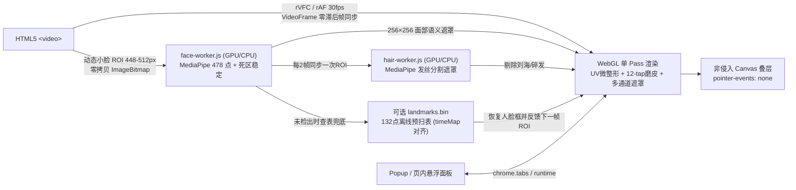

# 实时美颜（桌面 Chromium MV3 + iOS Safari）

> 本机实时网页视频美颜方案 —— **WebGL 单 Pass 26 项美颜/微整形 + MediaPipe 478 点人脸追踪**，无需服务器、不上传任何视频帧，桌面扩展零后台常驻开销，同时提供支持 **剧场全屏 + 一键 90° 横屏** 的 iOS Safari 用户脚本。

[](#)
[](#ios-safari-安装与横屏全屏)
[](#)
[](CHANGELOG.md)
[](LICENSE)

---

## 核心特性

- **100% 本机离线推理与渲染**：所有视频帧、人脸关键点与发丝分割均在用户本机处理，零远端 API、零数据上报。
- **可选：视频本地缓存 + 离线预扫防掉妆 + 内置播放器**（见下方「本地缓存与内置播放器」）：边看边把分片落到本地磁盘，支持对已缓存分片离线预扫人脸关键点（`prescan`）并在回看时查表兜底、显著减少侧脸/模糊/远景掉妆；打开 `http://127.0.0.1:8765/` 即可回看，**原站关掉、token 过期都不影响**，完整保留 26 项美颜面板。
- **最小权限 & 按域名显式开关**：美颜面板与控制条可按需交互，透明 HLS 缓存模块（`grab-hook`）与原站自制控制条（`player-bar`）**默认关闭**，由用户在美颜面板中按站点手动开关与即时热切（B 站 / YouTube 单独由 `cache-hook` 处理 MSE 流）。
- **Wink / 剪映专业级 26 项分项美颜（单 Pass WebGL 管线）**：
  - **美肤（7 项）**：磨皮（12-tap 保边双边近似）、质感保留（高频肤质细节还原，避免塑料脸）、美白（高光保护冷白提亮）、红润（苹果肌暖色提气色）、去黑眼圈、淡法令纹、去油光（T 区高光柔化）。
  - **美型（8 项）**：瘦脸（下颌线收窄）、窄颧骨、下巴长短（`-50 ~ +50` 双向精调）、大眼、眼尾上扬（`-50 ~ +50` 双向精调）、瘦鼻、嘴型大小（`-50 ~ +50` 双向精调）、微笑唇；内置纵横比校正与侧脸对称度 `yawFactor` 自动衰减，避免侧脸背景拉扯。
  - **美妆（5 项）**：亮眼、立体修容（鼻影 + 下颌微阴影）、润唇口红 + **4 款唇色风格**（裸粉 / 蜜桃橘 / 玫瑰豆沙 / 复古正红）、牙齿美白。
  - **调色（6 项）**：清晰锐化（眼唇细节保边增强）、亮度曝光（`-50 ~ +50`）、对比度（`-50 ~ +50`）、饱和度（`-50 ~ +50`）、色温冷暖（`-50 ~ +50`）、氛围柔光（Orton 风格高光漫射）；全画幅调色在无脸或降级回退场景下同样生效。
  - **预设与方案管理**：内置 7 档风格预设（自然清透 / 冷白质感 / 日系柔光 / 纯欲微调 / 网感精修 / 减龄打底 / 归零）、本地「我的方案」保存、参数 JSON 导入导出与 **Wink/小红书中文配方文本一键解析**（直接粘贴 `小脸+20 眼睛倾斜-29 鼻子大小+34 口红/豆沙+18 饱和度-20 色温-8` 即可自动识别并跳过非面部项），双击任意滑块可单项归零。
- **零滞后帧同步 + 独立发丝分割**：
  - 渲染主循环通过 `VideoFrame` 原子锁帧匹配对应视频帧（0.00ms 音画脸型滞后），由 `requestVideoFrameCallback`（自动回退 `requestAnimationFrame`）驱动；
  - 独立 `face-worker.js`（GPU Delegate 优先、CPU XNNPACK 回退）结合主脸 IoU 锁定、运动自适应死区稳定器与 `448–512px` 小脸动态高倍 ROI 裁切（净像素提升 `+34% ~ +66%`）；
  - 独立 `hair-worker.js`（MediaPipe `hair_segmenter`，每 2 帧分割 1 次，GPU 冷启动预热 + 6s 看门狗）精准剔除刘海与碎发区域，防止磨皮美白糊白发丝。
- **主流播放器通用适配 & 保护边界尊重**：
  - 自动适配 **XGPlayer（抖音等）**、**Plyr**、**Bilibili**、**YouTube** 与通用 HTML5 `<video>`（含开放 Shadow DOM 与同源 `iframe`）；
  - 精准支持 `object-fit: contain` / `cover` / `fill` 叠层对齐、悬停小预览降权、上下刷视频切条自动跟随、失焦暂停静态调参、容器全屏保持与原生 `<video>` 全屏自动回退；
  - 严格区分 **保护信号**（检测到 EME `mediaKeys` / `encrypted` 事件立即跳过取帧并保持原画）与 **取帧结果**（`可取帧 / 等待画面 / 跨域受限 / EME 已跳过 / 失败未确认`）；
  - **L0–L3 自动性能降级** 与 `webglcontextlost` 恢复，关闭美颜或离页时完整释放 Worker 与 WebGL 上下文。

---

## 架构概览



---

## 快速安装（桌面端 Chromium 浏览器）

### 方式一：直接下载 Release 预构建包（推荐普通用户）
1. 前往 [Releases 页面](https://github.com/woshixiaozhan123/realtime-beauty/releases) 下载 `realtime-beauty-v1.1.0.zip` 并解压。
2. 打开浏览器扩展管理页：
   - Chrome：`chrome://extensions`
   - Edge：`edge://extensions`
   - ego(lite)：`ego://extensions`
3. 开启右上角 **开发者模式** → 点击 **加载已解压/未打包的扩展程序** → 选择解压后的文件夹（包含 `manifest.json` 的目录）。
4. 打开任意 HTML5 视频页，点击工具栏扩展图标即可查看诊断并开启实时美颜。

### 方式二：从源码克隆构建（开发者）
> 需要 Node.js >= 18（零 npm 第三方运行时依赖）。

```bash
git clone https://github.com/woshixiaozhan123/realtime-beauty.git
cd realtime-beauty

# 1. 下载官方离线 MediaPipe WASM 与 478 点人脸模型到 vendor/mediapipe/
npm run setup

# 2. 校验语法、manifest 与资源完整性
npm run check

# 3. 打包可直接分发/提审的干净 zip 到 dist/
npm run build
```

> 若跳过 `npm run setup` 直接加载源码，扩展依然可以正常运行，并自动进入 **「WebGL 肤色保边回退模式」**（磨皮 / 质感保留 / 美白 / 红润 / 去油光 / 全部 6 项画面调色立即可用）。

---

## 本地缓存与内置播放器（完全可选）

> **不启动这个服务，扩展照常工作。** 美颜、播放器控制条、B站/YouTube 的 v2 缓存全都不依赖它。
> 只有「把分片存到本地硬盘」和「媒体库页面」需要它。只想要美颜的话，直接跳过这一节。

`cache-server/` 是一个可选的本地 FastAPI 服务（`127.0.0.1:8765`），提供两件事：

1. **透明缓存**：把播放器的 m3u8 改写到本地代理，每个分片先问本地、未命中才回源并顺手存一份。零额外流量，看完即已缓存。
2. **媒体库**：浏览器打开 `http://127.0.0.1:8765/` 即进入媒体库，点开就能回看，自带同一套 26 项美颜面板，**不需要扩展也能跑**。

```bash
cd cache-server
pip install -r requirements.txt
python main.py          # 打开 http://127.0.0.1:8765/
```

### 离线中文字幕（可选）

在面板的「本地字幕」里选「中文字幕」或「双语字幕」。打开本站缓存后，字幕会优先处理播放头和前方已落盘的分片。拖动进度条后会调高新位置的优先级。已经生成的原文和译文保存在对应视频的缓存目录，重新播放时可直接复用。

转写用 Whisper small，翻译用混元 Hy-MT2 1.8B Q4，默认都在 CPU 上运行。模型准备好后，字幕服务只读本机分片，在本机完成转写和翻译。

在 `cache-server` 目录用现有 Python 环境安装可选依赖：

```powershell
python -m pip install -r requirements-subtitles.txt
python -c "from huggingface_hub import snapshot_download; print(snapshot_download('Systran/faster-whisper-small'))"
$env:RB_SUBS_LLAMA_BIN = "C:\tools\llama.cpp\llama-server.exe"
$env:RB_SUBS_MT_MODEL = "C:\models\Hy-MT2-1.8B-Q4_K_M.gguf"
python main.py
```

将两个路径换成本机文件位置。混元模型和运行程序可从 [混元模型主页](https://huggingface.co/tencent/Hy-MT2-1.8B-GGUF) 和 [llama.cpp Releases](https://github.com/ggml-org/llama.cpp/releases) 获取。如果 Whisper 权重放在自定义目录，可设置 `RB_SUBS_WHISPER_DIR`。默认按可用逻辑核数分配最多 4 个 CPU 线程，可用 `RB_SUBS_THREADS` 调整。

「字幕性能」默认选自动。服务先用 CPU 兼容档出字幕，再在没有待生成分片时用固定短句试跑可用翻译档位，计入模型启动耗时。可以手动选 CPU 兼容、CPU 多核或 GPU 翻译，实际使用的档位会显示在面板上。Whisper 始终在 CPU 转写。

GPU 翻译需要支持 Vulkan 的 llama-server。可将该版本路径填入 `RB_SUBS_LLAMA_GPU_BIN`；已有的 CPU 版路径继续放在 `RB_SUBS_LLAMA_BIN`。显存余量不足、后端不可用或运行失败时，服务会使用 CPU 兼容档。同一段已生成字幕可跨档复用。

### 缓存默认是关的，按站点自己开

不想要某个站的视频被存下来？默认就是关的。要缓存时，在美颜面板「当前视频」卡片里打开 **「本站缓存」** 开关即可 —— 按域名记忆，开启后正在播的视频会原地热切到本地代理，不用刷新。

### 也可以自己随时删

缓存进度下面就是两个删除按钮，确认后立刻释放磁盘，不用去媒体库翻：

```
已缓存 130/374 片 · 35% · 70 MB
删除本视频 · 130 片          清空本站 · 1 条 · 70 MB
```

- **删除本视频**：只删当前这条
- **清空本站**：删该站点在本地缓存的全部视频（按条目真实所属站点算，不是当前页面的域名）
- 如果「本站缓存」开关还开着，删完会从当前位置重新开始缓存，弹窗里会提示

### 缓存会自动清理

服务后台每小时巡检一次，两条规则同时生效：

| 规则 | 默认 | 说明 |
|---|---|---|
| 保留天数 | 7 天 | 超过 7 天没看过（`lastAccessAt`）就删 |
| 容量上限 | 20 GB | 超了就按「最久没看」从旧到新删，直到降下来 |

媒体库页顶部会显示当前占用和规则，带「立即清理」按钮。规则可用环境变量调整：

```bash
RB_CACHE_MAX_AGE_DAYS=7      # 0 = 不限天数
RB_CACHE_MAX_GB=20           # 0 = 不限容量
RB_CACHE_SWEEP_INTERVAL_MIN=60
RB_CACHE_SWEEP=false         # 完全关掉自动清理
```

### 离线关键点预扫（可选，减少复杂镜头掉妆）

侧脸、运动模糊或远景小脸容易超过单帧实时检测极限，导致短暂回退为全帧肤色美颜。预扫模块可在本地对**已落盘的 TS 分片**做一次 4fps 离线扫描（**绝不回源拉流量**），生成 `132` 个核心点位的紧凑二进制表 `landmarks.bin`（10 分钟视频约 1.36 MB），在内置播放器回看时先查表兜底：

```bash
# 单跑扫描一条已缓存视频，并用自检脚本验证输出
cd cache-server
python prescan.py <safeKey>
python ../scripts/check_landmarks.py ~/Videos/grab-cache/<safeKey>/landmarks.bin
```

- **HTTP 接口**：`POST /api/prescan/{key}`（触发异步扫描，`?force=1` 重扫）、`GET /api/prescan/{key}`（查进度）、`DELETE /api/prescan/{key}`（删预扫文件）、`GET /lm/{key}`（下载二进制表），`/api/library` 同步返回 `hasPrescan` 标记。
- **时间轴对齐**：`mode=cached` 仅播放已缓存分片时，`player.html` 会基于实际 `#EXTINF` 时长生成分段映射表，确保查表不因跳过未缓存分片而错位。
- **环境变量**：`RB_PRESCAN_FPS`（默认 `4`）、`RB_PRESCAN_MAX_FRAMES`（默认 `400000`）、`RB_PRESCAN_AUTO`（默认 `false`）。
- 实测同一 2 分钟片段开启预扫后，`face_mask` 覆盖率较关闭前相对提升 `+50%`，渲染帧率仍稳定在 `~30 fps`。

**为什么缓存要单独跑一个进程，而不是做进扩展里**：

- 目标 CDN 会校验 TLS 指纹，需要 `curl_cffi impersonate="chrome"` 才能拿到分片；
- 一集长片可能好几 GB，落到磁盘比塞 IndexedDB/OPFS 可靠（MV3 service worker 30 秒就被回收，也扛不住长下载）；
- 抽帧缩略图与离线解码要用本机 ffmpeg，离线关键点扫描也避免占用浏览器播放线程。

**服务没启动时会自动降级**：扩展探测 `/health` 失败 → `serverOnline=false` → 不改写任何 m3u8 → 原站播放器行为与没装扩展完全一致。

- 播放列表由**磁盘状态**现场生成，默认只列已落盘分片，原站 token 过期也能完整回看。
- 详细架构、实测数据与变更记录见 [HANDOVER.md](HANDOVER.md) 与 [CHANGELOG.md](CHANGELOG.md)。

---

## iOS Safari 安装与横屏全屏

仓库内置与桌面端完全同步的 iOS Safari 用户脚本：[ios/realtime-beauty-ios.user.js](ios/realtime-beauty-ios.user.js)（同样具备全部 26 项参数、7 档预设、Wink 中文配方解析与可选 478 点追踪）。

### 安装步骤（Userscripts / Stay）
1. 在 App Store 安装免费开源的 **Userscripts**（或 **Stay**），并在 iOS「设置 → Safari 浏览器 → 扩展」中开启并授予网站权限。
2. 下载或直接从 Raw 链接安装脚本：
   `https://raw.githubusercontent.com/woshixiaozhan123/realtime-beauty/main/ios/realtime-beauty-ios.user.js`
3. 若使用 **Userscripts**：将脚本保存到 iCloud Drive /「我的 iPhone」下的 Userscripts 目录，刷新 Safari 视频页即可在右下角看到悬浮球。

### iOS 美颜剧场全屏 & 90° 横屏
- iOS 原生视频全屏会由系统 `AVPlayer` 接管并遮挡网页叠层；点击悬浮球旁的 **`⛶ 全屏`**（或面板底部的 **`⛶ 美颜全屏`**）即可进入美颜剧场全屏，完整保留美颜、进度条拖拽、倍速和实时调参。
- 即使手机开启了「竖排方向锁定」，点右上角 **`↻ 横屏90°`** 也能一键旋转横屏铺满观看。

---

## 浏览器兼容性与实测表现

在开启硬件加速的 Windows 桌面端通过可控测试页与主流视频站实测：

| 浏览器 | 状态 | 离线 478 点人脸遮罩 | 典型渲染耗时 (P95) |
| :--- | :--- | :--- | :--- |
| **Google Chrome** | ✅ 已验证 | 支持（CPU XNNPACK） | ~3.0–3.3 ms（L0） |
| **Microsoft Edge** | ✅ 已验证 | 支持（CPU XNNPACK） | ~3.0 ms（L0） |
| **ego(lite)** | ✅ 已验证 | 支持（CPU XNNPACK） | ~2.9–3.0 ms（L0） |

---

## 目录结构

```text
realtime-beauty/
├── manifest.json                 # MV3 清单（icons + wasm-unsafe-eval）
├── CHANGELOG.md                  # 版本与功能更新日志
├── HANDOVER.md                   # 架构说明与实测交接文档
├── icons/                        # 16 / 48 / 128 扩展图标
├── popup/                        # 26 项 Wink/剪映专业分项调参面板、预设、JSON 方案与诊断
├── content/
│   ├── engine.js                 # 主引擎：零滞后帧同步、WebGL管线、L0-L3降级、prescan兜底
│   ├── overlay-ui.js             # 页面悬浮调参面板、按站缓存开关与删除入口
│   ├── player-bar.js             # 全站可选原站内嵌播放控制条
│   └── grab-hook.js              # 透明 HLS 缓存 hook（按域名开关 + 改写 m3u8 到本地代理）
├── worker/
│   ├── face-worker.js            # 离主线程 MediaPipe 478 点推理与运动自适应稳定器
│   └── hair-worker.js            # 离主线程 MediaPipe 发丝分割（刘海/碎发防误磨皮）
├── ios/                          # iOS Safari 用户脚本（26 项调参 + 美颜剧场全屏 + 90° 横屏）
├── cache-server/                 # 可选本地服务：透明缓存 + 离线预扫 + 媒体库（FastAPI）
│   ├── hls_proxy.py              #   v4 分片级透明缓存
│   ├── prescan.py / prescan_api.py # 离线人脸关键点预扫（132点二进制 + HTTP API）
│   ├── maintenance.py            #   缓存定时自动清理（天数 / 容量上限）
│   ├── webui.py                  #   媒体库 / 内置播放器 / 本地播放列表 / 缩略图
│   └── web/                      #   播放器前端（hls.js + chrome API 垫片 + 复用 engine.js）
├── vendor/mediapipe/             # 离线 MediaPipe 模型与 ES Module WASM（npm run setup 拉取）
├── test-page/index.html          # 可控边界测试页（双人脸、同源iframe、cover/contain、全屏、EME）
├── scripts/                      # setup / check / check_landmarks / build 脚本
└── .github/workflows/ci.yml      # GitHub Actions 自动校验与打包工作流
```

---

## 已知边界与限制

- **受 DRM (EME) 保护的流媒体**：遵循浏览器安全与版权机制，检测到 `mediaKeys` 或 `encrypted` 事件后主动跳过取帧并保持原画播放。
- **无 CORS 头的跨域直链视频**：浏览器 `texImage2D` 会按规范抛出 `SecurityError`，诊断面板将明确标记为「跨域受限」并保持原画（MSE `blob:` 流与同源流不受此限制）。
- **跨域 `iframe` 与自绘 `<canvas>` 播放器**：当前在诊断面板标记为待适配提示。
- **严格 CSP 网站**：若目标站点 CSP 禁止 `blob:` Worker，引擎会自动平滑降级至「肤色保边回退模式」，不中断播放。

---

## 开源协议与致谢

本项目采用 [MIT License](LICENSE) 开源；第三方模型与组件许可见 [THIRD_PARTY_NOTICES.md](THIRD_PARTY_NOTICES.md)。欢迎通过 [CONTRIBUTING.md](CONTRIBUTING.md) 参与贡献。
